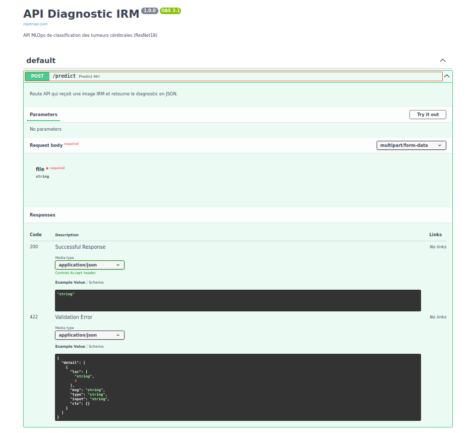
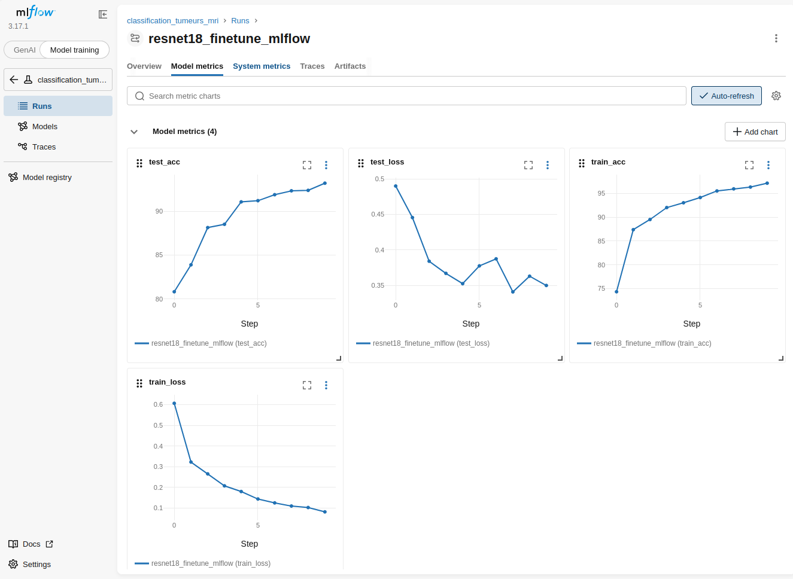
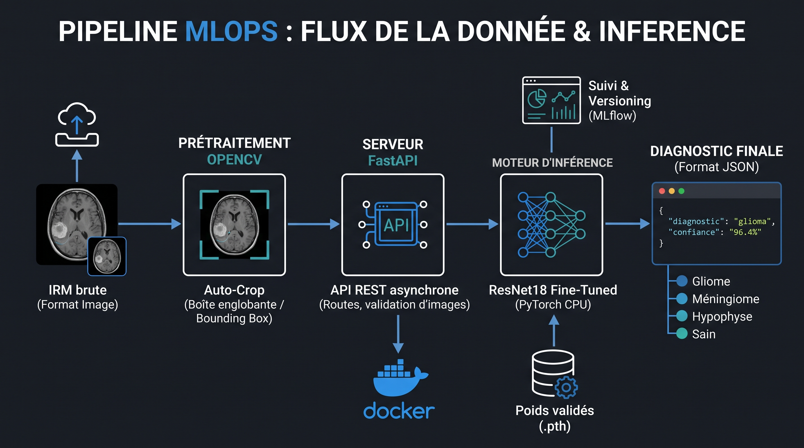

# Projet_MRI
# 🧠 Pipeline MLOps & Deep Learning : Classification de Tumeurs Cérébrales (IRM)


## 📌 Contexte Clinique et Objectif d'Ingénierie
La classification automatique des tumeurs cérébrales par IRM est souvent biaisée par des métriques globales trompeuses (Accuracy). Ce projet vise à construire un système d'aide au diagnostic de niveau industriel, capable de classifier 4 pathologies (Gliome, Méningiome, Tumeur de l'hypophyse, Cerveau sain) tout en **minimisant mathématiquement le risque de faux négatifs critiques**.

## 🚀 Architecture du Pipeline

Ce projet dépasse le prototypage en Jupyter Notebook et intègre les standards MLOps de production :

### 1. Modélisation & Optimisation (PyTorch)
- **Architecture :** Transfer Learning sur ResNet18.
- **Fine-Tuning Différentiel :** Gel des blocs convolutifs superficiels (`layer1` à `layer3`) et déblocage profond (`layer4`) avec un taux d'apprentissage microscopique ($10^{-6}$) pour éviter le *catastrophic forgetting*.
- **Loss Pondérée :** Implémentation d'une `CrossEntropyLoss` asymétrique (poids x3 sur les gliomes) pour contraindre mathématiquement le modèle à sur-sécuriser la pathologie la plus difficile.
- **Scheduler :** Intégration d'un `ReduceLROnPlateau` pour stabiliser la descente de gradient.

### 2. MLOps, Déploiement & Inférence
- **MLflow :** Traçabilité totale des hyperparamètres, versioning des poids et suivi des courbes de Loss/Accuracy.
- **FastAPI :** Conteneurisation de la fonction d'inférence dans une API REST asynchrone à haute performance.
- **Docker :** Fichier `Dockerfile` industriel multi-stage, optimisé spatialement (PyTorch CPU-only & OpenCV Headless).

## 📊 Performances Cliniques
Le modèle optimisé a atteint une **Accuracy globale de 93%**, avec un comportement de sauvegarde clinique validé :
- **Rappel (Recall) sur le Méningiome :** 94%
- **Faux négatifs critiques :** Réduction drastique confirmée par la matrice de confusion.

---

## 🔍 Audit d'Interprétabilité et Limites du Modèle (Grad-CAM)

En ingénierie clinique, l'explicabilité (XAI) est aussi critique que la précision. Un audit rigoureux via **Grad-CAM** a été mené pour vérifier si le réseau se concentrait sur les bonnes caractéristiques physiologiques. 

**Diagnostic d'un biais spatial (Shortcut Learning) :**
L'audit a révélé une faille structurelle sur certains faux négatifs. Sur l'exemple ci-dessous (un Gliome central évident classé à tort en Cerveau Sain), la Heatmap Grad-CAM démontre que le modèle ignore totalement la masse nécrotique au centre du parenchyme :


*Analyse :* Le réseau a développé un **raccourci mathématique**. Plutôt que d'analyser la texture tumorale, les filtres de convolution s'accrochent à la géométrie saine de la paroi crânienne périphérique pour deviner la classe.

**Plan d'action pour la V2 :**
Le recadrage actuel par boîte englobante (Bounding Box via OpenCV) a supprimé le bruit de fond mais n'a pas suffi à éliminer l'anneau osseux. La prochaine itération du pipeline nécessitera l'intégration d'un réseau de segmentation de type **U-Net** pour réaliser un *Skull Stripping* chirurgical absolu en amont de la classification.

---
## 💻 Interface d'Inférence (FastAPI)
Le modèle est accessible via une API REST asynchrone documentée, prête à recevoir des flux d'images brutes et à renvoyer les diagnostics structurés en JSON :



## 📈 Suivi d'Expérimentation (MLflow)
Afin de garantir la reproductibilité et la gouvernance du modèle, l'intégralité des hyperparamètres (Learning rates différentiels, poids de la Loss) et des métriques de validation sont tracés via MLflow :



### 🌐 Architecture Globale & Flux de la Donnée
Le schéma ci-dessous illustre le parcours d'une IRM, de son téléversement brute jusqu'à la réponse de diagnostic, en mettant en évidence le rôle de chaque brique (Docker, FastAPI, OpenCV, PyTorch, MLflow) :



## ⚙️ Installation et Déploiement (Docker)

Le modèle est encapsulé et prêt à être déployé sur n'importe quelle infrastructure locale ou Cloud.

1. **Cloner le dépôt :**
```bash
git clone https://github.com/Ahmed-beji/Projet_MRI.git
cd Projet_MRI